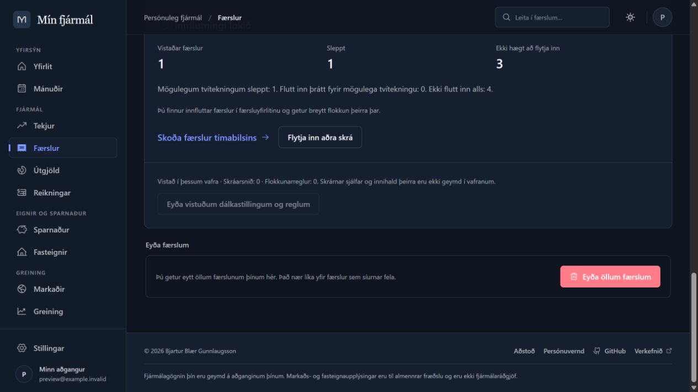

# Feature and speed test report

Tested 30 September–1 October 2026. Application commit: `018a246e7677954efa73aeab50af54d781fc893b`.

## Result

The tested core workflows passed. Two confirmed display defects remain, and signed-in navigation has some noticeably slower first visits. This is a completed test pass, not a claim that every feature, browser, failure condition or production account lifecycle has been verified.

Production was checked with anonymous HTTP requests and read-only navigation in the account the user signed in to. Financial writes, profile changes, exports and deletion requests were exercised only against the local in-memory fixture. No production financial records were edited. No application fix or production deployment was made as part of this pass.

## Automated checks

| Check | Result | Scope |
| --- | --- | --- |
| Application tests | 177 passed, 0 failed | Auth, account data, feedback, amounts, periods, transactions, import review, savings, bills, provider failures and privacy controls; service boundaries mocked |
| PostgreSQL bill/savings checks | 33 passed | Actual disposable PostgreSQL 17.10, migrations, concurrent writes, safe retries, ownership and deletion cascades |
| PostgreSQL ownership checks | 11 passed | Cross-owner references rejected, migration replay, concurrent changes and fresh schema |
| Production HTTP checks | 35 passed | Seven public pages sampled three times, twelve protected routes redirect to login, both unauthenticated export formats return 401 |
| Lint, production build, type checking | Passed | Node.js 22.23.3; optimized build configured for the loopback fixture |
| Production dependency audit | 0 known vulnerabilities | `npm run audit:production`, 1 October; does not establish complete application security |

The first sandboxed test/build attempts were unable to create child processes. They were rerun successfully with the required execution permission; those environment failures are not application failures.

## Confirmed issues

### 1. Half-króna rounding is inconsistent

Reproduction: save an expense of 1,250.50 ISK and filter transactions to that record. The expense total displays `1.251 kr.`, while the negative balance displays `-1.250 kr.`.

`lib/format.ts:4` uses `Math.round(value)`, whose negative half rounding differs from positive half rounding. The underlying saved amount remained 1250.5; this is a display discrepancy, not observed data loss. Use a consistent rounding rule for positive and negative amounts and add a focused regression check.

### 2. Months without a budget are labelled over budget

Reproduction: view Expenses with historical spending but no budget for those months. History displays `0 kr.` budget, `0%`, and `Yfir áætlun` together. A missing plan should be clearly distinguished from an explicitly chosen zero budget.

Both mobile and desktop branches in `app/(app)/expenses/page.tsx:154` calculate usage as zero when the budget is zero and infer the status solely from spending minus budget. The current-month empty-plan message is clearer than these history rows.

### Minor compatibility observation

The local deletion-request status rendered its date as `Oct 1, 2026` inside otherwise Icelandic text. The component requests `is-IS` through `Intl.DateTimeFormat`; verify locale fallback in supported browsers and consider the application's explicit Icelandic date formatter.

## Browser feature coverage

Browser: Codex in-app Chromium. Local server: optimized Next.js production build with `scripts/responsive-preview.cjs --production --writable`, loopback-only synthetic backend. Its sessions and financial records are simulated, not a real Supabase staging project. The fixture was restarted on 1 October after its one-day synthetic session expired; the second run reseeded sample data.

| Feature | Observed result |
| --- | --- |
| Login / logout | Incorrect password produced the expected error; correct local login succeeded; logout redirected to login and a subsequent protected-page request stayed at login. User also signed into production for read-only checks. |
| Dashboard and summaries | Dashboard, monthly summary, income, expenses and analytics rendered; saved sample changes propagated into totals. |
| Transactions | Created an expense, verified `1234567` became `1.234.567`, edited amount/date/description, searched for the record and saved bulk categorization. |
| Import | Pasted a five-row CSV. Detected the existing duplicate, rejected impossible date/income/zero rows, imported exactly one valid expense, and followed the result link to that record. Icelandic characters were retained. |
| Income | Saved a separate 120,000 ISK sample income and verified its new entry. |
| Budgets | Created a 1,000,000 ISK overall budget; summary and remaining balance updated. Missing-budget history defect recorded above. |
| Bills | Linked an existing expense, verified paid/unpaid totals, unlinked it and confirmed the expense was still available. Created a 9,500 ISK bill and recorded a new expense/payment. |
| Savings | Injected a lost response after a committed 25,000 ISK contribution. Retry retained the request and produced one contribution; balance increased from 3,875,000 to 3,900,000. |
| Savings preferences | Moved pension below housing and excluded pension from housing/goal totals. Reload retained order and selection: total savings 10,670,000; housing 3,900,000; goal savings 6,020,000. |
| Profile / categories / appearance | Saved the synthetic profile name, created a custom category, and switched to light appearance. |
| CSV / JSON exports | Both files downloaded and parsed. Both contained 36 transactions; JSON also included all ten expected data tables, account information and savings-preference fields. No real account export was downloaded. |
| Deletion requests | Recorded a local request, saw pending status, cancelled it, and verified the request form returned. This does not automatically erase an account. Actual deletion cascades were covered by the disposable PostgreSQL tests. |
| Market data | Inflation, policy rates and FX rendered. FX and economy tabs worked. No TradingView iframe was present before a choice or after declining. Optional third-party chart rendering is not certified by this pass. |
| Real estate | Housing data and sample-property filtering loaded. Calculator at 60,000,000 purchase price, 20% equity, zero interest and 20 years produced a 48,000,000 loan, 200,000 monthly payment and zero interest. |
| Scrolling / anchors | A Page Down immediately after navigating moved the page; the new-transaction anchor revealed its form. This is a Chromium check, not proof of touch scrolling on Safari. |
| Responsive forms | Transactions, bills, savings, settings, expenses and income had no page-wide horizontal overflow or out-of-bounds form controls at requested widths 390 and 320 pixels. Available layout widths were 375 and 305 after the scrollbar. |

Some pointer clicks in the in-app browser did not activate controls reliably. Keyboard activation worked. Do not classify these as a confirmed production defect without reproducing with ordinary mouse/touch input in a normal browser.

## Speed measurements

### Production HTTP delivery

Sequential anonymous requests from this Windows machine, three samples per public page, without artificial throttling. Full-response times measure delivery of HTML, not when a browser finishes rendering. A new connection affects the first request.

| Page | Median full response | Slowest of 3 |
| --- | ---: | ---: |
| Homepage | 58 ms | 565 ms |
| Login | 195 ms | 218 ms |
| Signup | 165 ms | 178 ms |
| Password recovery page | 164 ms | 171 ms |
| Help | 62 ms | 300 ms |
| Privacy | 230 ms | 243 ms |
| Demo | 378 ms | 1,074 ms |

Raw evidence: [HTTP samples](2026-09-30-http.json). Reproduce with `node scripts/http-smoke.cjs --output=<results.json>`. The script performs only anonymous GET requests; it is not a load test.

### Signed-in production navigation

Times run from keyboard activation of a navigation link until the main page heading is available. They include automation overhead. The sample is small and some routes were already cached or prefetched; these are observations, not percentiles or guaranteed user timings.

| Page | Observed time |
| --- | ---: |
| Dashboard | 1.04 s |
| Monthly overview | 1.61 s |
| Transactions | 1.75 s |
| Expenses | 1.16 s |
| Bills | 3.29 s first measured visit; 1.33 s repeat |
| Savings | 1.76 s |
| Settings | 1.38 s |
| Analytics | First content wait exceeded the browser-tool deadline; subsequently loaded without an error. Repeat: 0.75 s. |
| Markets | 0.44 s to heading; external data can finish later |
| Real estate | 0.44 s to heading; external data/calculator can finish later |

Local fixture navigation was mostly 0.48–1.28 s. Do not use those figures as production database performance. The initial local transactions sample measured only the loading shell and is excluded from this range.

Raw evidence: [browser timings and responsive measurements](2026-09-30/browser-results.json).

The next performance work should investigate the first authenticated bills/analytics loads and database request volume before adding more caching. Public HTML delivery was not the largest observed delay. Market/property headings must not be mistaken for completed provider loading.

## Remaining verification limits

- No physical iPhone Safari or Android test; date-picker alignment, touch scrolling and keyboard behavior still need device verification.
- No browser LCP/INP/CLS measurements, CPU/network throttling, or simultaneous-user stress test. The supported browser inspection interface did not expose Performance entries.
- No new production signup/confirmation-email/password-reset cycle. Auth branches have automated coverage; actual inbox delivery and link use remain unverified.
- No real Supabase staging two-user acceptance test. Local PostgreSQL exercised actual database policies; the browser fixture simulated Auth and REST responses.
- Browser import used pasted CSV. Excel decoding and many import edge cases have automated coverage; a real Excel upload journey remains unverified here.
- Transaction/category/budget/goal deletion, bulk erase, bill copying and all goal-edit combinations were not individually exercised through the browser. Relevant action/database behavior is covered by the automated suites, but that is a different level of evidence.
- Optional TradingView embed rendering in ordinary Safari/Chrome remains to be checked.

## Evidence

Sample-only import result (one saved, one duplicate skipped, three excluded):

